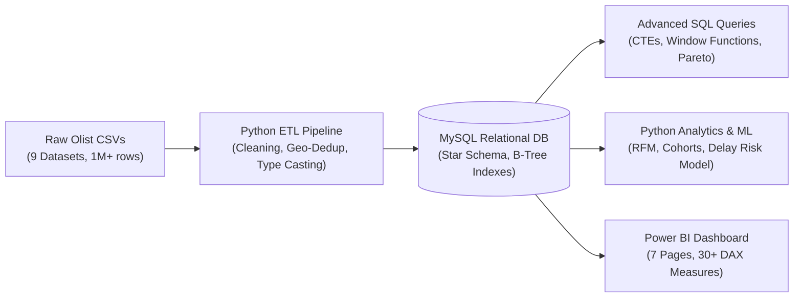
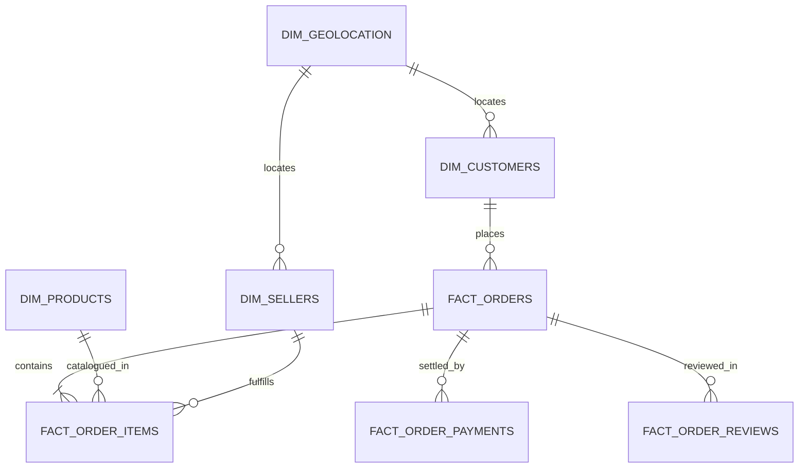

# End-to-End E-Commerce Data Analytics & Business Intelligence Platform

[](https://www.python.org/)
[](https://www.mysql.com/)
[](https://powerbi.microsoft.com/)
[](https://pandas.pydata.org/)
[](LICENSE)

An enterprise-grade, portfolio-ready Data Analytics and Business Intelligence platform built on the **Brazilian E-Commerce Public Dataset by Olist** (100k+ multi-marketplace orders). 

This project transforms 9 uncleaned, multi-granular CSV files into a 3NF/Star Schema **MySQL relational database**, orchestrates an automated Python **ETL pipeline**, executes **advanced SQL analytics** (CTEs, Window Functions), conducts statistical **RFM segmentation** and **cohort retention analysis**, and designs an interactive **7-page Power BI executive dashboard**.

---

## 📌 Table of Contents
1. [Project Architecture](#-project-architecture)
2. [Data Model & ER Diagram](#-data-model--er-diagram)
3. [Key Business Findings](#-key-business-findings)
4. [Project Structure](#-project-structure)
5. [End-to-End Pipeline & Modules](#-end-to-end-pipeline--modules)
6. [Power BI Dashboard Pages](#-power-bi-dashboard-pages)
7. [Getting Started & Setup Guide](#-getting-started--setup-guide)
8. [Advanced SQL Business Queries](#-advanced-sql-business-queries)
9. [Author & Acknowledgments](#-author--acknowledgments)

---

## 🏗 Project Architecture

The platform follows a modern, decoupled analytics engineering workflow:



---

## 🗄 Data Model & ER Diagram

The database is structured as a **Star/Snowflake hybrid schema** optimized for OLAP aggregations and sub-second analytical query execution:



- **`dim_customers`**: 99,441 records mapping order-level tokens (`customer_id`) to individual human entities (`customer_unique_id`).
- **`dim_products`**: 32,951 products enriched with English translations and imputed categories.
- **`dim_sellers`**: 3,095 marketplace merchants across 23 Brazilian states.
- **`dim_geolocation`**: Deduplicated into 19,015 unique postal code prefix centroids to eliminate Cartesian join bloat.
- **`fact_orders`**: 99,441 order lifecycle transactions.
- **`fact_order_items`**: 112,650 line-item purchases with pricing and freight costs.
- **`fact_order_payments`**: 103,886 split-payment transaction records.
- **`fact_order_reviews`**: 99,224 customer ratings and review comments with surrogate primary keys.

---

## 💡 Key Business Findings

| Focus Area | Key Data Finding | Business Implication & Strategic Action |
| :--- | :--- | :--- |
| **Customer Retention** | **3.01% repeat purchase rate**; Month 1 retention drops below 0.5% across all cohorts. | Olist functions as an acquisition-led search marketplace; converting one-off buyers to repeat purchasers via automated 90-day win-back campaigns on *Hibernating High Spenders* can unlock R$ 420K+ in high-margin GMV. |
| **Logistics Asymmetry** | São Paulo (SP) delivers in **8.3 days** (5.2% delay rate), while Northern states average **24–28 days** (18.5%–22.8% delay rate). | Interstate transit across Brazil creates severe logistics bottlenecks. Establish regional cross-docking nodes in the Northeast (Bahia/Pernambuco) to compress delivery times by 7+ days. |
| **Customer Sentiment** | On-time orders average **4.30 / 5.00** stars; delayed orders drop drastically to **2.15 / 5.00** (58.4% 1-star ratings). | Delivery punctuality is the single highest predictor of customer reviews. Mitigating seller dispatch delays directly protects the platform's public reputation. |
| **Payment Financing** | Credit cards drive **75%+ of GMV** with an average of **3.5 installments**; >68% of orders over R$ 500 utilize 6+ installments. | Brazilian shoppers heavily rely on zero-interest credit financing; optimizing installment options directly accelerates Average Order Value. |

---

## 📂 Project Structure

```
.
├── database/                             # SQL schema, views, and business query suites
│   ├── 01_schema_setup.sql               # Relational DDL, PK/FK, and index definitions
│   ├── 02_views_and_marts.sql            # Analytical views & reporting marts
│   └── queries/                          # Modular advanced SQL query suites
│       ├── 01_revenue_and_growth.sql     # Revenue trends, MoM growth & AOV
│       ├── 02_customer_dynamics.sql      # Repeat purchases & SQL RFM segmentation
│       ├── 03_product_and_seller_performance.sql # Pareto 80/20 & seller SLAs
│       ├── 04_logistics_and_fulfillment.sql      # Delivery delays & regional freight
│       └── 05_payment_and_reviews.sql    # Installments & review sentiment drivers
├── src/                                  # Python modular engineering codebase
│   ├── __init__.py
│   ├── config.py                         # Environment variables & DB settings
│   ├── logger.py                         # Structured logging utility
│   ├── db_connector.py                   # SQLAlchemy & PyMySQL database manager
│   ├── data_cleaner.py                   # Transformation & cleaning functions
│   ├── data_profiler.py                  # Automated dataset profiler & integrity audit
│   ├── etl_pipeline.py                   # Full extraction, loading & verification pipeline
│   ├── export_analytical_data.py         # Curated export utility for Power BI Desktop
│   └── analytics/                        # Advanced analytics & modeling
│       ├── __init__.py
│       ├── rfm_segmentation.py           # Python RFM scoring & segmentation
│       ├── cohort_analysis.py            # Acquisition cohorts & retention matrix
│       └── delivery_delay_model.py       # Logistics delay risk & feature correlations
├── notebooks/                            # Publication-grade Jupyter Notebooks
│   ├── 01_exploratory_data_analysis.ipynb
│   ├── 02_rfm_customer_segmentation.ipynb
│   └── 03_cohort_retention_analysis.ipynb
├── power_bi/                             # Business Intelligence assets
│   ├── data_model_architecture.md        # Star schema modeling & Dim_Date guide
│   ├── dax_measures.md                   # Complete catalog of 30+ production DAX measures
│   └── visual_design_guide.md            # Page-by-page visual configuration guide
├── docs/                                 # Architecture & executive documentation
│   ├── stage1_dataset_profiling_report.md
│   ├── database_schema_er.md
│   ├── architecture_diagram.md
│   └── business_insights_report.md
├── .env.example                          # Safe environment variable template
├── .gitignore                            # Production gitignore
├── requirements.txt                      # Pinned Python dependencies
└── README.md                             # Flagship project documentation
```

---

## 📊 Power BI Dashboard Pages

The platform includes detailed architectural specifications for a **7-page executive dashboard**:

1. **Executive Overview:** High-level executive KPI cards (`GMV`, `Total Orders`, `AOV`, `On-Time Delivery %`), MoM GMV trajectory, top category treemap, and customer review gauge.
2. **Sales Performance:** Cumulative sales velocity, monthly sales breakdown, payment method market share, and installment count distribution.
3. **Customer Intelligence:** Customer acquisition curves, geographic customer density map, RFM segmentation matrix, and repeat buyer conversion metrics.
4. **Product & Seller Analytics:** Category Pareto 80/20 contribution curve, seller leaderboard table with fulfillment SLA rates, and price-to-freight scatter plots.
5. **Delivery & Logistics:** Actual vs. estimated delivery duration distributions, delivery delay hotspot maps by state, and logistics delay decomposition trees.
6. **Customer Satisfaction:** Review score distribution, correlation matrix between delivery delays and 1-star reviews, and freight ratio sentiment impacts.
7. **Geographic Sales Analysis:** Brazilian state choropleth map, regional spend distributions, and interstate seller-to-buyer logistics corridors.

*Refer to [power_bi/visual_design_guide.md](power_bi/visual_design_guide.md) for full visual layout and formatting rules, and [power_bi/dax_measures.md](power_bi/dax_measures.md) for the DAX measure formulas.*

---

## 🚀 Getting Started & Setup Guide

### 1. Prerequisites
- Python 3.10+
- MySQL Server 8.0 & MySQL Workbench
- Microsoft Power BI Desktop

### 2. Clone the Repository & Configure Environment
```bash
git clone https://github.com/AaryarajPatil/End-to-End-E-Commerce-Data-Analytics-Business-Intelligence-Platform.git
cd End-to-End-E-Commerce-Data-Analytics-Business-Intelligence-Platform

# Create virtual environment
python -m venv venv
# Windows:
venv\Scripts\activate
# Linux/macOS:
source venv/bin/activate

# Install dependencies
pip install -r requirements.txt

# Configure environment variables
cp .env.example .env
```
Edit `.env` with your local MySQL credentials:
```ini
DB_HOST=localhost
DB_PORT=3306
DB_USER=root
DB_PASSWORD=your_password
DB_NAME=olist_ecommerce_db
```

### 3. Run Dataset Profiling & Verification
```bash
python src/data_profiler.py
```

### 4. Execute the Python ETL Pipeline
This automatically builds the database, creates the relational tables, cleanses raw files, ingests records in dependency order, and sets up analytical views:
```bash
python src/etl_pipeline.py
```

### 5. Run Advanced Analytics Modules
```bash
# Calculate customer RFM segmentation
python src/analytics/rfm_segmentation.py

# Compute cohort retention matrix
python src/analytics/cohort_analysis.py

# Evaluate delivery delay drivers
python src/analytics/delivery_delay_model.py
```

### 6. Export Curated Data for Power BI
```bash
python src/export_analytical_data.py
```
*Open Power BI Desktop, load the curated datasets from `data/curated/` or connect directly to MySQL, and follow [power_bi/visual_design_guide.md](power_bi/visual_design_guide.md) to configure your visuals.*

---

## 👨‍💻 Author
**Aaryaraj Patil**  
*Computer Science & Engineering (AI & ML Specialization)*  
GitHub: [@AaryarajPatil](https://github.com/AaryarajPatil)  
Repository: [End-to-End-E-Commerce-Data-Analytics-Business-Intelligence-Platform](https://github.com/AaryarajPatil/End-to-End-E-Commerce-Data-Analytics-Business-Intelligence-Platform)
