# End-to-End System Architecture
**Platform:** Brazilian E-Commerce Analytics & Business Intelligence  
**Author:** Aaryaraj Patil  

---

## 1. High-Level Data Flow Architecture

```mermaid
flowchart TD
    subgraph S1["1. Raw Data Source Layer"]
        CSV1["Customers CSV (99.4K)"]
        CSV2["Orders CSV (99.4K)"]
        CSV3["Order Items CSV (112.6K)"]
        CSV4["Payments CSV (103.8K)"]
        CSV5["Reviews CSV (99.2K)"]
        CSV6["Products CSV (32.9K)"]
        CSV7["Sellers CSV (3.1K)"]
        CSV8["Geolocation CSV (1.0M)"]
        CSV9["Category Translations (71)"]
    end

    subgraph S2["2. Data Engineering & ETL Pipeline (Python)"]
        ETL["src/etl_pipeline.py"]
        CLEAN["src/data_cleaner.py"]
        GEO_AGG["Geo Centroid Aggregator<br/>(1M -> 19K unique Zips)"]
        TRANS_MAP["Category Translator & Imputer"]
        LOG["Centralized Logger & Validator"]
        ETL --> CLEAN
        CLEAN --> GEO_AGG
        CLEAN --> TRANS_MAP
    end

    subgraph S3["3. Enterprise Relational Warehouse (MySQL 8.0)"]
        DB[(olist_ecommerce_db)]
        DIMS["Dimension Tables<br/>dim_customers<br/>dim_products<br/>dim_sellers<br/>dim_geolocation"]
        FACTS["Fact Tables<br/>fact_orders<br/>fact_order_items<br/>fact_order_payments<br/>fact_order_reviews"]
        VIEWS["Analytical Views & Data Marts<br/>vw_order_summary<br/>vw_monthly_sales_kpi<br/>vw_seller_performance<br/>vw_customer_rfm_source"]
        DB --> DIMS
        DB --> FACTS
        DB --> VIEWS
    end

    subgraph S4["4. Advanced Analytics & Modeling Layer"]
        SQL_ENG["Advanced SQL Queries<br/>CTEs, Window Functions, Pareto 80/20"]
        RFM_MOD["Python RFM Segmentation<br/>Quintile Scoring & Customer Value"]
        COHORT["Cohort Retention Analysis<br/>Monthly Acquisition Heatmaps"]
        PRED["Delivery Delay Risk Model<br/>Logistics Bottleneck Modeling"]
    end

    subgraph S5["5. Business Intelligence Layer (Power BI Desktop)"]
        PBI_MODEL["Star Schema Model & Date Dimension"]
        DAX["30+ DAX Production Measures<br/>Time Intelligence, KPIs, NPS"]
        P1["1. Executive Overview"]
        P2["2. Sales Performance"]
        P3["3. Customer Intelligence"]
        P4["4. Product & Seller Analytics"]
        P5["5. Delivery & Logistics"]
        P6["6. Customer Satisfaction"]
        P7["7. Geographic Sales Analysis"]
    end

    S1 --> S2
    S2 --> S3
    S3 --> S4
    S3 --> S5
    S4 --> S5
```

---

## 2. Layer Responsibilities & Technical Stack

| Layer | Tools / Technologies | Key Responsibilities |
| :--- | :--- | :--- |
| **Data Ingestion** | Python 3, Pandas, PyMySQL, SQLAlchemy | Type casting, missing value imputation, geolocation deduplication, foreign key dependency loading. |
| **Relational Storage** | MySQL Server 8.0, InnoDB Engine | 3NF/Star Schema hybrid, B-Tree index optimization, referential integrity constraints, analytical SQL views. |
| **Analytics Engine** | Advanced SQL (MySQL), Python, Scipy, Scikit-Learn | MoM growth calculations, cohort analysis, customer RFM segmentation, logistic delay risk feature correlation. |
| **Business Intelligence** | Microsoft Power BI Desktop, DAX | Dimensional modeling, DAX time-intelligence measures, interactive 7-page executive dashboard with drill-through. |
| **Version Control & DevOps** | Git, GitHub, Python-dotenv | Modular directory structure, credentials isolation, environment templating, professional documentation. |
