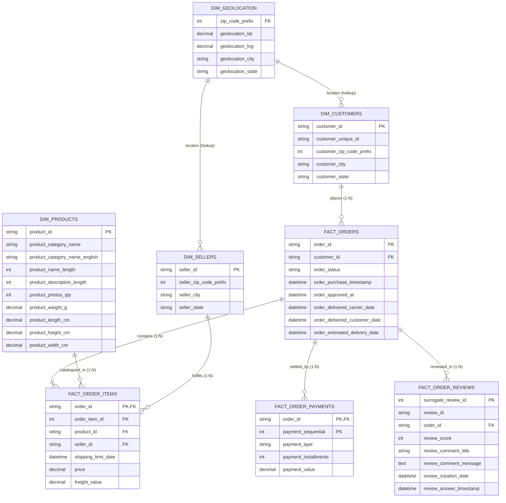

# Relational Database Schema & Entity-Relationship (ER) Documentation
**Database:** `olist_ecommerce_db` (MySQL 8.0)  
**Author:** Aaryaraj Patil  

---

## 1. Entity-Relationship (ER) Diagram

---

## 2. Table Specifications & Cardinality

### 1. `dim_customers`
- **Primary Key:** `customer_id` (VARCHAR 32)
- **Business Key:** `customer_unique_id` (VARCHAR 32)
- **Indexes:** `idx_cust_unique`, `idx_cust_zip`, `idx_cust_state`
- **Volume:** 99,441 records

### 2. `dim_sellers`
- **Primary Key:** `seller_id` (VARCHAR 32)
- **Indexes:** `idx_seller_zip`, `idx_seller_state`
- **Volume:** 3,095 records

### 3. `dim_products`
- **Primary Key:** `product_id` (VARCHAR 32)
- **Indexes:** `idx_prod_category`
- **Volume:** 32,951 records

### 4. `dim_geolocation`
- **Primary Key:** `zip_code_prefix` (INT)
- **Indexes:** `idx_geo_state`, `idx_geo_city`
- **Aggregation:** 19,015 distinct Brazilian postal prefixes (median centroid coordinates).

### 5. `fact_orders`
- **Primary Key:** `order_id` (VARCHAR 32)
- **Foreign Keys:** `customer_id` -> `dim_customers(customer_id)`
- **Indexes:** `idx_orders_customer`, `idx_orders_status`, `idx_orders_purchase_date`
- **Volume:** 99,441 records

### 6. `fact_order_items`
- **Composite Primary Key:** `(order_id, order_item_id)`
- **Foreign Keys:** 
  - `order_id` -> `fact_orders(order_id)`
  - `product_id` -> `dim_products(product_id)`
  - `seller_id` -> `dim_sellers(seller_id)`
- **Volume:** 112,650 records

### 7. `fact_order_payments`
- **Composite Primary Key:** `(order_id, payment_sequential)`
- **Foreign Keys:** `order_id` -> `fact_orders(order_id)`
- **Volume:** 103,886 records

### 8. `fact_order_reviews`
- **Surrogate Primary Key:** `surrogate_review_id` (INT AUTO_INCREMENT)
- **Foreign Keys:** `order_id` -> `fact_orders(order_id)`
- **Indexes:** `idx_reviews_order`, `idx_reviews_score`, `idx_reviews_review_id`
- **Volume:** 99,224 records
